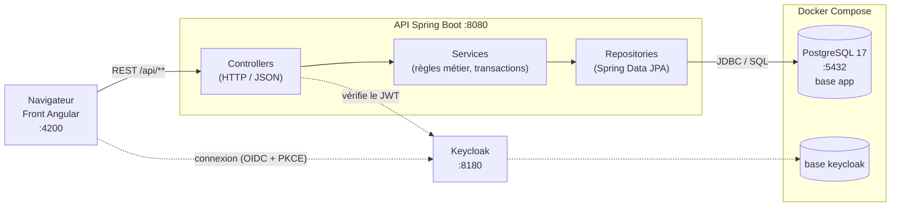
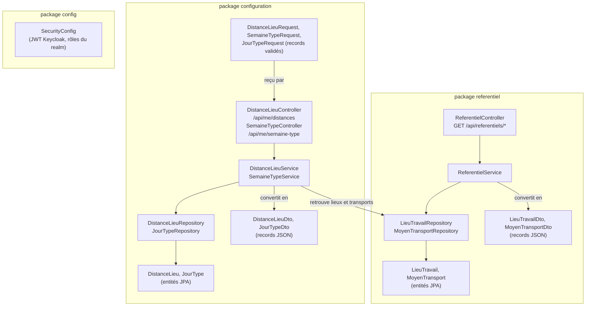
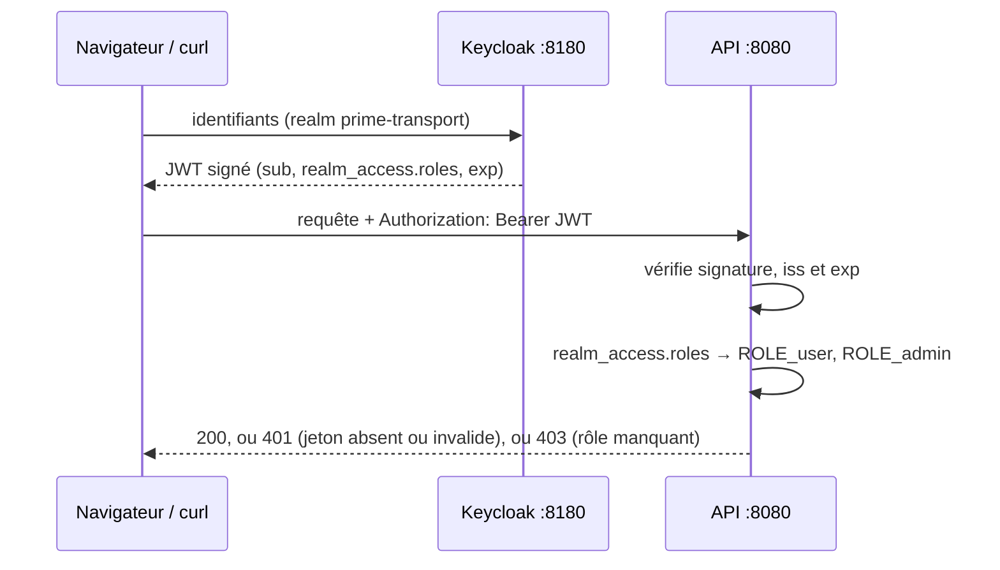
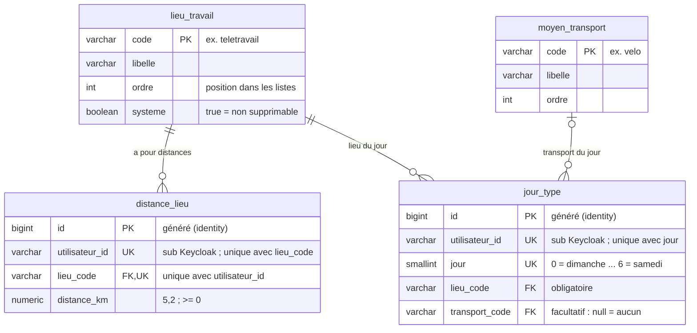

# Architecture

Ce document décrit l'état **actuel** du backend. Il est mis à jour à chaque étape :
un élément en pointillés est prévu mais pas encore réalisé.

> Les schémas sont écrits en [Mermaid](https://mermaid.js.org/). Ils s'affichent
> directement sur GitLab/GitHub et dans l'aperçu Markdown de VS Code
> (`Ctrl+Shift+V`, avec l'extension « Markdown Preview Mermaid Support »).

## Vue d'ensemble



Les flèches en pointillés ne transportent pas de données métier : connexion de
l'utilisateur, et récupération par l'API de la clé publique de Keycloak (une fois,
puis mise en cache).

| Élément | Rôle | État |
| --- | --- | --- |
| Front Angular | Interface utilisateur (dépôt `tuto_angular_dsfr`) | Existant, pas encore branché sur l'API |
| API Spring Boot | Expose la configuration en REST et applique les règles métier | Étapes 1 à 3 faites |
| PostgreSQL | Stocke référentiels et configuration ; schéma géré par Flyway | Étapes 1 à 3 faites |
| Keycloak | Authentification, rôles `user` et `admin` ; realm importé depuis `keycloak/realm-export.json` | Étape 3 faite |

## Découpage du code

Un package par fonctionnalité, et dans chacun le même empilement de couches.
Une requête traverse les couches de haut en bas, la réponse remonte sous forme de DTO.



## API

Toutes les routes exigent un JWT valide (en-tête `Authorization: Bearer ...`),
sinon **401**. Les routes `/api/me/...` concernent l'utilisateur connecté, identifié
par le `sub` du jeton, et exigent le rôle `user`, sinon **403**.

| Méthode | Route | Rôle | Effet | Réponses |
| --- | --- | --- | --- | --- |
| GET | `/api/referentiels/lieux` | authentifié | Les 6 lieux, triés | 200 |
| GET | `/api/referentiels/transports` | authentifié | Les transports, triés | 200 |
| GET | `/api/me/distances` | `user` | Tous les lieux avec leur distance, 0 si jamais saisie | 200 |
| PUT | `/api/me/distances/{lieuCode}` | `user` | Crée ou modifie la distance d'un lieu | 200, 400 si invalide |
| GET | `/api/me/semaine-type` | `user` | Les 7 jours, du dimanche (0) au samedi (6) | 200, 404 si jamais enregistrée |
| PUT | `/api/me/semaine-type` | `user` | Remplace la semaine ; samedi et dimanche forcés à `conges-ferie` sans transport | 200, 400 si invalide |

Restent ouvertes sans jeton : `/actuator/health` et la documentation Swagger
(`/swagger-ui.html`, `/v3/api-docs`).

Erreurs encore provisoires (traitées à l'étape 4) : un lieu ou un transport
inexistant, et un jour présent deux fois, répondent 500.

## Sécurité



- **Vérification** : l'API ne connaît que l'`issuer-uri` du realm (`application.yml`).
  Elle en déduit la clé publique de Keycloak, et vérifie chaque jeton localement.
- **Rôles** : `SecurityConfig` convertit `realm_access.roles` en rôles Spring
  (`user` → `ROLE_user`). Le rôle `admin` est composite : il inclut `user`.
- **Utilisateur** : les controllers lisent le `sub` du jeton (`@AuthenticationPrincipal Jwt`)
  et le passent aux services comme `utilisateurId`. C'est un UUID stable, pas le nom de connexion.
- **Sans état** : aucune session ni cookie côté API, d'où la protection CSRF désactivée.
- **Jetons** : valables 5 minutes (`accessTokenLifespan`).

Comptes de développement (définis dans le realm) :

| Utilisateur | Mot de passe | Rôles |
| --- | --- | --- |
| `alice` | `alice` | `user` |
| `bob` | `bob` | `admin` (donc aussi `user`) |

Obtenir un jeton en ligne de commande, grâce à `directAccessGrantsEnabled` sur le client
`angular-front` (réservé au développement) :

```bash
curl -s -d client_id=angular-front -d username=alice -d password=alice -d grant_type=password \
  http://localhost:8180/realms/prime-transport/protocol/openid-connect/token
```

Le realm n'est importé qu'au premier démarrage de Keycloak : une modification de
`realm-export.json` n'est prise en compte qu'après suppression du realm.

Dans les tests, `jwt()` de `spring-security-test` simule un utilisateur sans appeler
Keycloak. Il n'utilise pas la conversion des rôles : les rôles se donnent explicitement
(`.authorities(new SimpleGrantedAuthority("ROLE_user"))`).

## Base de données

Schéma de la base `app`, tel que créé par les migrations Flyway
(`src/main/resources/db/migration`).



| Migration | Contenu |
| --- | --- |
| `V1__referentiels.sql` | Tables `lieu_travail` et `moyen_transport`, avec les 6 lieux et les 2 transports initiaux |
| `V2__distance_lieu.sql` | Table `distance_lieu` : une distance par utilisateur et par lieu |
| `V3__jour_type.sql` | Table `jour_type` : un lieu et un transport facultatif par utilisateur et par jour |

Points à noter :

- `utilisateur_id` n'est pas une clé étrangère : les utilisateurs vivent dans Keycloak, dans une autre base.
- Les clés étrangères vers `lieu_travail` n'ont pas de `ON DELETE CASCADE`. Postgres refuse donc de supprimer un lieu qui a encore des distances ou des jours type.
- Dans `jour_type`, `transport_code` accepte `NULL` : « aucun transport » n'est pas une ligne de `moyen_transport`.
- `jour` suit la convention de `Date.getDay()` côté front : 0 = dimanche, 6 = samedi.

## Tenir ce document à jour

À chaque étape :

1. **Nouvelle migration Flyway** : ajouter les tables dans le schéma `erDiagram`, avec leurs relations, et une ligne dans le tableau des migrations.
2. **Nouveau package ou composant** : l'ajouter au découpage du code.
3. **Élément réalisé** : retirer la classe `prevu` pour qu'il passe en trait plein, et mettre à jour la colonne « État ».
