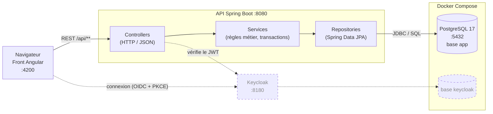
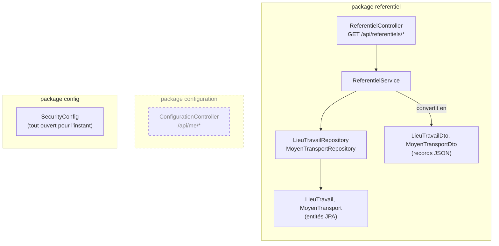
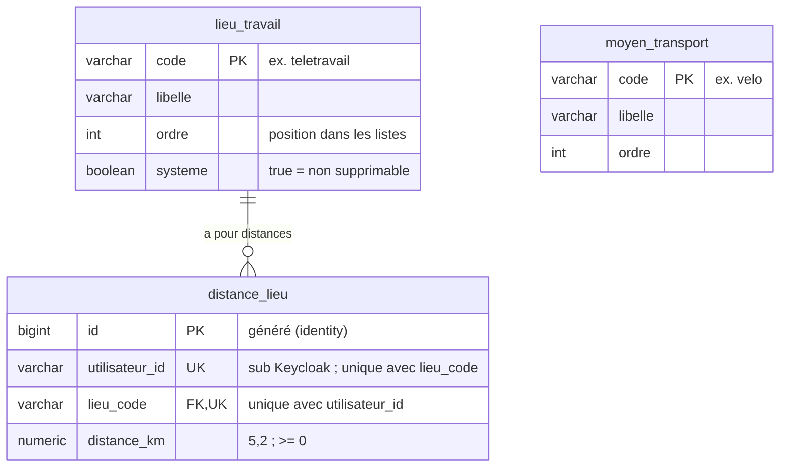

# Architecture

Ce document décrit l'état **actuel** du backend. Il est mis à jour à chaque étape :
un élément en pointillés est prévu mais pas encore réalisé.

> Les schémas sont écrits en [Mermaid](https://mermaid.js.org/). Ils s'affichent
> directement sur GitLab/GitHub et dans l'aperçu Markdown de VS Code
> (`Ctrl+Shift+V`, avec l'extension « Markdown Preview Mermaid Support »).

## Vue d'ensemble

| Élément | Rôle | État |
| --- | --- | --- |
| Front Angular | Interface utilisateur (dépôt `tuto_angular_dsfr`) | Existant, pas encore branché sur l'API |
| API Spring Boot | Expose la configuration en REST et applique les règles métier | Étape 1 faite |
| PostgreSQL | Stocke référentiels et configuration ; schéma géré par Flyway | Étape 1 faite |
| Keycloak | Authentification, rôles `user` et `admin` | Prévu (étape 3) |

## Découpage du code

Un package par fonctionnalité, et dans chacun le même empilement de couches.
Une requête traverse les couches de haut en bas, la réponse remonte sous forme de DTO.

## Base de données

Schéma de la base `app`, tel que créé par les migrations Flyway
(`src/main/resources/db/migration`).

| Migration | Contenu |
| --- | --- |
| `V1__referentiels.sql` | Tables `lieu_travail` et `moyen_transport`, avec les 6 lieux et les 2 transports initiaux |
| `V2__distance_lieu.sql` | Table `distance_lieu` : une distance par utilisateur et par lieu |

Points à noter :

- `utilisateur_id` n'est pas une clé étrangère : les utilisateurs vivent dans Keycloak, dans une autre base.
- La clé étrangère vers `lieu_travail` n'a pas de `ON DELETE CASCADE`. Postgres refuse donc de supprimer un lieu qui a encore des distances.

**Prochaine table (étape 2)** : `jour_type`, avec sept jours par utilisateur. Chaque jour a un lieu et un transport facultatif.

## Tenir ce document à jour

À chaque étape :

1. **Nouvelle migration Flyway** : ajouter les tables dans le schéma `erDiagram`, avec leurs relations, et une ligne dans le tableau des migrations.
2. **Nouveau package ou composant** : l'ajouter au découpage du code.
3. **Élément réalisé** : retirer la classe `prevu` pour qu'il passe en trait plein, et mettre à jour la colonne « État ».
